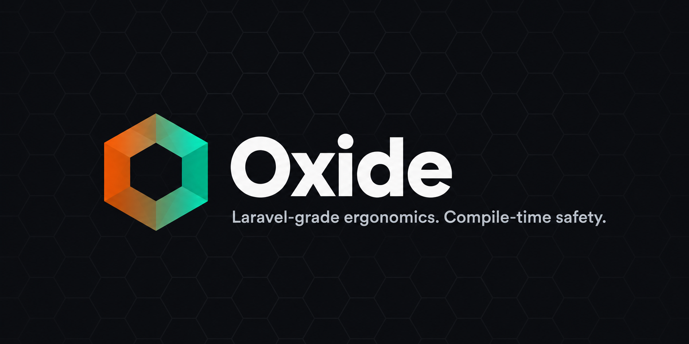

<p align="center">
  
</p>

<p align="center">
  <a href="https://github.com/oxide-hq/oxide-framework/actions/workflows/ci.yml"></a>
  <a href="#license"></a>
  <a href="rust-toolchain.toml"></a>
  <a href="https://oxide-hq.github.io/oxide-framework/"></a>
</p>

**Oxide** is a Laravel-inspired web framework for Rust. It aims to give you Laravel's developer
ergonomics — a service container, form requests, route-model binding, a fluent test client — while
everything is checked at compile time. It is built on [Axum 0.8](https://docs.rs/axum) and
[Tokio](https://tokio.rs).

> **Status:** early development. APIs will change.

## Quickstart

```bash
cargo install --git https://github.com/oxide-hq/oxide-framework oxide-cli
oxide new blog-app      # guided: preset, database, starter, AI agent skill
cd blog-app
cargo test              # the starter's feature tests
cargo run               # http://127.0.0.1:3000/api/v1/posts
```

Inside an app, `oxide make:model Comment -m`, `oxide make:controller Comment --resource` and
`oxide make:request StoreCommentRequest` generate files and register their modules, like
`php artisan make:*`.

## Documentation

The full guide lives at **[oxide-hq.github.io/oxide-framework](https://oxide-hq.github.io/oxide-framework/)**:
routing, controllers, form requests, route-model binding, the ORM and HTTP testing, with Laravel
comparisons throughout. Its source is [`docs/index.html`](docs/index.html), deployed by
[`docs.yml`](.github/workflows/docs.yml) on every push to `main`.

## Features

| Laravel concept         | Oxide                                                                        |
| ----------------------- | ---------------------------------------------------------------------------- |
| Configuration           | `#[derive(Config)]` sections from `config/*.toml`, `.env` and env vars, validated at boot |
| Collections & helpers   | `CollectionExt` on any iterator, `Str`/`Stringable`, `Arr`, `Number`, `Pipeline`, `retry`             |
| Providers & Application | `Application::builder().provider(..).build()`, typed container (singleton/scoped/transient, `dyn` contracts), `Inject<T>` |
| Logging & Context       | `config/logging.toml` channels (stderr, file, daily, JSON, stacks) on `tracing`; request-id `Context` on every line |
| Service container       | `#[derive(ServiceContainer)]` on your state, `#[derive(Service)]` on services |
| Facades                 | `AppContext::resolve::<Mailer>()` inside `facade_middleware` (task-local)     |
| `FormRequest`           | `#[derive(FormRequest)]` + the `Validated<T>` extractor                       |
| Eloquent models         | `#[derive(Model)]` → `Post::query().where_published(true).get(&db)`           |
| Databases & migrations  | SQLite or PostgreSQL (`postgres` feature); `db.migrate(&sqlx::migrate!(..))`  |
| Route-model binding     | `Bind<Post>` — automatic for `Model`s, or `impl RouteBindable` by hand        |
| Routes & resources      | `routes! { prefix(..) { resource("/posts", PostController); } }`              |
| Named routes / `route()`| `route!("posts.show", post = 42)` → `/api/v1/posts/42`                        |
| Error responses         | `OxideHttpError` → Laravel-shaped JSON for 400 / 403 / 404 / 422 / 500        |
| HTTP tests              | `TestClient` with chainable `assert_*` methods                                |

## Example

```rust
use std::sync::{Arc, Mutex};

use axum::http::request::Parts;
use axum::{Json, Router, routing::put};
use oxide_http::prelude::*;
use serde::{Deserialize, Serialize};

#[derive(Clone, Debug, Default, Service)]
struct Mailer { sent: Arc<Mutex<Vec<String>>> }

#[derive(Clone, Debug, Default, Service)]
struct Db { /* connection pool, ... */ }

#[derive(Clone, Debug, Default, ServiceContainer)]
struct AppContext { mailer: Mailer, db: Db }

#[derive(Clone, Debug, Serialize)]
struct Post { id: u64, title: String }

impl RouteBindable<AppContext> for Post {
    type Id = u64;
    fn param_name() -> &'static str { "post" }
    async fn bind_from_state(id: u64, _ctx: &AppContext) -> Result<Option<Self>, OxideHttpError> {
        Ok((id == 1).then(|| Post { id, title: "Hello".into() }))
    }
}

#[derive(Debug, Deserialize, Validate, FormRequest)]
#[form_request(authorize)]
struct UpdatePost {
    #[validate(length(min = 5, message = "Title must be at least 5 characters"))]
    title: String,
}

impl Authorize<AppContext> for UpdatePost {
    async fn authorize(&self, parts: &Parts, _ctx: &AppContext) -> bool {
        parts.headers.get("x-user-role").is_some_and(|role| role == "editor")
    }
}

// Services, the bound model and the validated payload are all plain handler arguments.
async fn update_post(
    mailer: Mailer,
    Bind(mut post): Bind<Post>,
    Validated(req): Validated<UpdatePost>,
) -> Json<Post> {
    post.title = req.title;
    mailer.sent.lock().unwrap().push(format!("Post {} updated", post.id));
    Json(post)
}

fn app(ctx: AppContext) -> Router {
    Router::new()
        .route("/posts/{post}", put(update_post))
        .layer(axum::middleware::from_fn_with_state(ctx.clone(), facade_middleware::<AppContext>))
        .with_state(ctx)
}
```

`Validated<T>` accepts `application/json` and `application/x-www-form-urlencoded` bodies. It
returns `400` for a malformed body, `403` when `authorize` returns `false`, and `422` when
validation fails:

```json
{
  "message": "The given data was invalid.",
  "errors": { "title": ["Title must be at least 5 characters"] }
}
```

### Routing

`routes!` is a Laravel-style routing DSL that expands into an `OxideRouter`, a thin wrapper around
`axum::Router` that also records route names and patterns:

```rust
let router: OxideRouter<AppContext> = routes! {
    prefix("/api/v1") {
        get("/health", health).name("health");

        // index, store, show, update (PUT + PATCH), destroy — named "posts.<action>"
        resource("/posts", PostController);

        post("/posts/{post}/publish", PostController::publish).name("posts.publish");

        prefix("/admin").name("admin.") {
            middleware(axum::middleware::from_fn(require_admin)) {
                resource("/categories", CategoryController, only = [index, show]);
            }
        }
    }
};

let app = router.with_state(ctx); // OxideRouter<()> — pass to axum::serve(..) via `.into()` or to TestClient

assert_eq!(route!("posts.show", post = 1), "/api/v1/posts/1");
assert_eq!(route!("posts.index", page = 2), "/api/v1/posts?page=2"); // extra params → query string
```

A resource controller is a plain struct whose associated `async fn`s are Axum handlers
(`PostController::index`, `::store`, `::show`, `::update`, `::destroy`). The member parameter is
the singular of the last segment (`/posts` → `{post}`, `/categories` → `{category}`); override it
with `param = "..."`. Duplicate route names and paths that don't start with `/` are compile
errors. Inside handlers, the `UrlGenerator` extractor generates URLs from the same registry.

### Models (`oxide-orm`)

`#[derive(Model)]` turns an `sqlx::FromRow` struct into an Eloquent-style model backed by SQLite
or, with the `postgres` feature, PostgreSQL. Every query method is generated per field and binds
its values as parameters (`?` on SQLite, `$n` on PostgreSQL).

```rust
#[derive(Debug, Clone, Serialize, sqlx::FromRow, Model)]
#[model(table = "posts")]
pub struct Post {
    pub id: i64,
    pub author_id: i64,
    pub title: String,
    pub published: bool,
}

let db = DatabasePool::connect_in_memory().await?;
let posts = Post::query()
    .where_published(true)
    .where_title_contains("Oxide")
    .order_by_id_desc()
    .limit(10)
    .get(&db)
    .await?;
let prolific = Post::query().where_author_id_gte(10).count(&db).await?;

let mut post = Post::insert(&db, &NewPost { author_id: 1, title: "Hi".into(), published: false }).await?;
post.title = "Hello".into();
post.save(&db).await?;
post.delete(&db).await?;
```

The derive also generates `find`, `find_or_fail`, `all`, `create`, `where_<field>_in`,
`_not`, `_null`/`_not_null` on `Option` fields, `first`, `first_or_fail` and `delete` on queries,
plus `has_many`/`belongs_to` helpers. It implements `RouteBindable` for any state that provides a
`DatabasePool`, so `Bind<Post>` loads the row from `{post}` and answers 404 when it is missing.
`OrmError::NotFound` converts to a 404 and database errors to an opaque 500.

`DatabasePool::connect(url)` picks the driver from the URL (`sqlite:` or `postgres://`),
`db.migrate(&sqlx::migrate!("./database/migrations"))` applies numbered SQL migrations, and
`DatabasePool::connect_fresh(url)` gives each test an isolated database (a new in-memory SQLite
database, or a throwaway PostgreSQL schema). The suite in
[`crates/oxide-orm/tests/suite`](crates/oxide-orm/tests/suite) runs a full CRUD API against both.

### Testing

```rust
#[tokio::test]
async fn editors_can_update_posts() {
    TestClient::new(app(AppContext::default()))
        .put("/posts/1")
        .header("X-User-Role", "editor")
        .json(&serde_json::json!({ "title": "A brand new title" }))
        .send()
        .await
        .assert_ok()
        .assert_json_path("title", "A brand new title");
}
```

`assert_json_path` accepts dot notation (`data.0.title`) or a JSON pointer (`/data/0/title`). Other
assertions include `assert_created`, `assert_not_found`, `assert_forbidden`,
`assert_unprocessable` and `assert_validation_error_for("field")`.

The full lifecycle suite is in
[`crates/oxide-http/tests/lifecycle_test.rs`](crates/oxide-http/tests/lifecycle_test.rs).

### Dependencies in your crate

Applications depend on the [`oxide`](crates/oxide) umbrella crate, which re-exports
`oxide-http` (as `oxide::http`) and `oxide-orm` (as `oxide::orm`) and gathers everything into
`oxide::prelude`. Oxide's derives detect it and generate `::oxide::...` paths, so you never need
the individual crates:

```toml
[dependencies]
oxide = { git = "https://github.com/oxide-hq/oxide-framework" } # features = ["postgres"]
```

Use `features = ["postgres-tls"]` for PostgreSQL servers that require TLS (`sslmode=require`); plain
`postgres` connects without TLS.

The `serde`, `Validate` and `sqlx::FromRow` derives come from those crates and refer to them by
name, so your crate also needs `serde`, `validator` (with `derive`) and `sqlx` as direct
dependencies.

## Workspace

| Crate                                            | Purpose                                                          |
| ------------------------------------------------ | ---------------------------------------------------------------- |
| [`oxide`](crates/oxide)                          | The umbrella crate apps depend on: re-exports both layers and a combined prelude |
| [`oxide-config`](crates/oxide-config)            | Typed configuration: `#[derive(Config)]`, `config/*.toml`, `.env`, environments |
| [`oxide-config-macros`](crates/oxide-config-macros) | The `Config` derive (re-exported by `oxide-config`) |
| [`oxide-support`](crates/oxide-support)          | Helpers: collections, strings, arrays, numbers, dates, pipelines, retry |
| [`oxide-foundation`](crates/oxide-foundation)    | Application bootstrap: `Application`, `ServiceProvider`, typed container |
| [`oxide-log`](crates/oxide-log)                  | Logging: channels, request `Context`, request-id middleware |
| [`oxide-http`](crates/oxide-http)                | Extractors, error contract, service container traits, `TestClient` |
| [`oxide-http-macros`](crates/oxide-http-macros)  | `Service`, `ServiceContainer` and `FormRequest` derives (re-exported by `oxide-http`) |
| [`oxide-orm`](crates/oxide-orm)                  | `DatabasePool`, `Model` trait, typed queries, migrations, `OrmError` (sqlx: SQLite, PostgreSQL) |
| [`oxide-orm-macros`](crates/oxide-orm-macros)    | `#[derive(Model)]` (re-exported by `oxide-orm`) |
| [`oxide-cli`](crates/oxide-cli)                  | The `oxide` binary: `oxide new` and the `make:*` generators |

## Development

You need stable Rust (pinned in [`rust-toolchain.toml`](rust-toolchain.toml)) and
[`just`](https://github.com/casey/just).
[`.cargo/config.toml`](.cargo/config.toml) links with `clang` + [`mold`](https://github.com/rui314/mold)
on x86_64 Linux; remove that block if you don't have them installed.

```bash
just test       # cargo test --workspace
just lint       # cargo clippy --workspace --all-targets -- -D warnings
just fmt        # cargo fmt --all
just ci         # fmt-check + lint + test
just e2e        # scaffold apps with `oxide new` and run their own tests
just coverage   # HTML line-coverage report (needs cargo-llvm-cov); CI fails below 85%
just deny       # cargo deny check (needs cargo-deny)
just expand     # cargo expand (needs cargo-expand)
```

## AI coding agents

The repository ships its conventions as an agent skill:
[`.claude/skills/oxide-eloquent-rust/SKILL.md`](.claude/skills/oxide-eloquent-rust/SKILL.md) for
Claude Code, mirrored to [`.cursor/rules/oxide-eloquent-rust.mdc`](.cursor/rules/oxide-eloquent-rust.mdc)
for Cursor. It covers the three-layer design trace, early returns, the five-action controller
rule, and the hard rules (no `unwrap`/`expect` in library code, no lock guard across `.await`,
bound SQL only). Edit the skill, then run `just sync-rules`; CI fails if the two drift.

## License

Licensed under either of

- Apache License, Version 2.0 ([LICENSE-APACHE](LICENSE-APACHE))
- MIT license ([LICENSE-MIT](LICENSE-MIT))

at your option.

Unless you explicitly state otherwise, any contribution intentionally submitted for inclusion in
this work by you, as defined in the Apache-2.0 license, shall be dual licensed as above, without
any additional terms or conditions.
